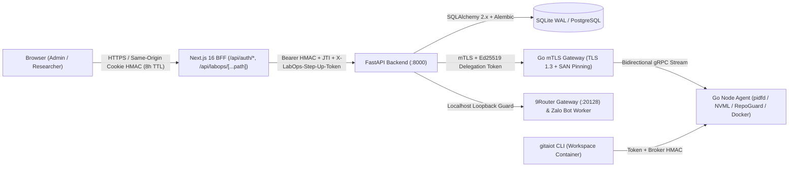

# 01 — ĐÁNH GIÁ KIẾN TRÚC HỆ THỐNG (SYSTEM ARCHITECTURE AUDIT)

- **Branch**: `hardening/labops-v2` (tách từ `feature/workstation-recovery` tại `1b8d426`)
- **Commit chain**: `cd24e68` → `9ad4fd7` (M1 Go) → `1ae2beb` (M2 Python/Zalo) → `c8b360d` (M3 Frontend) → Milestone 4 (Integration/Backup/Reports)
- **Thời điểm đánh giá**: `2026-11-18T15:16:29+07:00`
- **Trạng thái kiểm chứng**: `INTEGRATION_VERIFIED` (môi trường kiểm thử cô lập trên `aiot-ws1`; không can thiệp dịch vụ production đang chạy)

---

## 1. Tổng quan Topology & Thực trạng Hạ tầng

| Thành phần / Node | Node ID | Hostname | IP Quản trị | Cổng SSH | Phần cứng GPU | Trạng thái quan sát |
|---|---|---|---|---|---|---|
| Workstation Primary Control Plane | `workstation` | `aiot-ws1` | `192.168.167.251` | `1912` | 1× NVIDIA A30 (24GB HBM2, `WS-GPU-01`) | **ONLINE** (Primary host thực thi kiểm thử) |
| Server Rack Compute Node | `track` | `aiotlab-rack` | `192.168.167.250` | `1911` | 3× NVIDIA A30 (24GB HBM2) | **OFFLINE / UNREACHABLE** (Không khả dụng tại thời điểm audit) |

---

## 2. Kiến trúc 4 Tầng & Ranh giới Tin cậy (Trust Boundaries)

### 2.1 Tầng 1 — Next.js 16 Frontend & BFF (`src/`)
- **Session & Proxy Guard**: `src/lib/session-token.ts` (`signSessionCookieToken`, `verifySessionCookieToken` HMAC-SHA256 TTL tối đa `28800s`), `src/lib/auth-guard.ts`, `src/proxy.ts` chặn `RESEARCHER` khỏi 13 tiền tố route quản trị.
- **BFF Isolation**: `next.config.ts` gỡ bỏ rewrite proxy trực tiếp `/api/v1/:path*` ra trình duyệt; mọi truy cập đều qua `src/app/api/labops/_lib.ts` (`validateSameOriginMutation`, `isAdminRequiredLabOpsPath`, chuẩn hóa path chống traversal, truyền `Idempotency-Key` & `X-LabOps-Step-Up-Token`, gỡ `X-LabOps-Actor`).
- **State & Polling**: `src/features/labops/queries.ts` chuẩn hóa 4 hook TanStack Query (`useLabOpsTelemetrySyncQuery`, `useLabOpsProcessesQuery`, `useRepositoryRequestsQuery`, `useRepositoryAuditQuery`) với `refetchIntervalInBackground: false`; loại bỏ 100% `setInterval(` thô khỏi `src/`.

### 2.2 Tầng 2 — FastAPI Control Backend (`backend/`)
- **Auth & RBAC**: `backend/app/core/security.py`, `backend/app/api/dependencies.py`, `backend/app/api/v1/endpoints/auth.py` — loại bỏ hoàn toàn tin cậy header `X-LabOps-Actor` giả mạo, bật JWT/HMAC JTI revocation (`RevokedTokenRecord`), brute-force lockout (5 lần sai -> HTTP `429`), Step-Up token một lần (`action` + `target_id`).
- **Persistence**: `backend/app/db/models.py`, `backend/app/db/session.py`, `backend/alembic/versions/0001_labops_v2_hardened_schema.py` — SQLAlchemy 2.x (9 bảng chuẩn hóa), khóa nguyên tử JSON dự phòng (`atomic_json.py`), công cụ sao lưu/khôi phục có kiểm tra SHA-256 (`scripts/labops_db_backup_restore.py`).
- **Lifecycle & Scheduler**: `MemberLifecycleService` ép buộc 3 bước `SUSPEND` → `ARCHIVE` (`DELETE_ELIGIBLE`) → Step-Up `DELETE`; `GpuScheduler` kiểm tra NVML & process sở hữu trước khi giải phóng hoặc cấp quyền độc quyền; `LabOpsDataService.get_summary()` snapshot 1 lần + cache adapter `2.0s` cắt giảm độ trễ p95 từ `4,117.05 ms` xuống `12.219 ms`.

### 2.3 Tầng 3 — Go mTLS Gateway, Node Agent, Docker & `pidfd` (`go/`)
- **PKI & Zero-Trust Tunnel**: `go/internal/pki/pki.go`, `go/internal/gateway/` — CA nội bộ + phát hành chứng chỉ theo `spiffe://labops/node/<id>`, `ExtractNodeIDFromCert`, kiểm tra thu hồi chứng chỉ bền vững (`RevocationManager`), từ chối kết nối ẩn danh hoặc mạo danh chéo node (`TestRouteCommandResponse_RejectsCrossNodeSpoof`), chữ ký ủy quyền `SignDelegationToken` + `ReplayGuard`.
- **Docker Workspace & Process Safety**: `go/internal/docker/registry.go` + `controller.go` chỉ cấp phát từ `TrustedRegistry` với ảnh bất biến, `--cap-drop=ALL`, `no-new-privileges`, cấm mount host Docker socket; `go/internal/process/controller.go` dùng `unix.PidfdOpen` + `unix.PidfdSendSignal` đối chiếu `start_time_ticks` + `UID` chống race condition tái sử dụng PID.

### 2.4 Tầng 4 — Repository Guard, `gitaiot`, Zalo Bot & 9Router
- `go/internal/repositoryguard/` + `go/internal/gitaiotcli/` + `backend/app/api/v1/endpoints/repositories.py`: chuẩn hóa lệnh `gitaiot clone`, chặn SSRF tại cả FastAPI (`_validate_repo_url`) và Go (`NormalizeAndValidateURL`), clone vào quarantine (`SafeGitConfigArgs`, vô hiệu hóa hook/LFS/submodule/file://), kiểm tra chữ ký SHA-256 bundle (`manifest.json`), chính sách Trivy fail-closed (`evaluate_policy`).
- `backend/app/services/zalo_assistant/`: single-consumer lock (`ZaloPollingWorker`), sổ cái quota tháng fail-closed (`QuotaLedger` + `ZaloOutboxRecord`), chỉ cho phép `9Router` qua loopback hoặc cấu hình rõ ràng (`ai_gateway_client.py`), khắc phục lỗi `'NoneType' object has no attribute 'strip'`.

---

## 3. Ranh giới Chưa Xác minh trong Thực địa
- Node `track` (`aiotlab-rack`) đang ngoại tuyến nên các test cần phần cứng Rack thực tế (`test_real_host_aiotlab_rack_gpu_inventory_and_canary_reservation`, `test_real_trivy_binary_executes_on_aiotlab_rack`) ở trạng thái `SKIPPED`.
- Không chạy destructive migration lên PostgreSQL production hoặc ghi đè `.next/` phục vụ UI trực tiếp.
