# Kiến trúc Managed Git Clone

```mermaid
flowchart LR
    W["Git wrapper trong workspace"] --> C["aiotgit"]
    C -->|"HTTPS và credential workspace"| B["FastAPI Repository Broker"]
    B -->|"Danh tính broker ký HMAC"| G["Repository Guard trên Go Agent cục bộ"]
    G --> F["Resolve ref, fetch SHA và lịch sử vào quarantine"]
    F --> S["Trivy và policy"]
    S --> A["Tự động phê duyệt hoặc Admin quyết định"]
    A -->|"Approved"| D["Xác minh artifact, Docker registry và mount đích"]
    D --> T["Publish nguyên tử Git worktree thuộc UID/GID workspace"]
```

Go Agent thực hiện resolve và fetch. Repository Guard lưu trạng thái và audit trong thư mục dữ liệu cấu hình của Agent, với thư mục con `quarantine` và `approved_store` dành cho source tạm và artifact đã duyệt. Broker xác thực thành viên, workspace và scope. Agent xác minh container đang chạy, ID, image, UID/GID và bind mount thực tế trước khi dùng đường dẫn lưu trữ phía host.

Guard gọi `trivy fs` để quét lỗ hổng, secret và misconfiguration của cây tại commit đã chốt. Kết quả policy dẫn đến `AUTO_APPROVED`, `REVIEW_REQUIRED`, `REJECTED` hoặc `FAILED`. Admin có thể chuyển yêu cầu đang chờ sang `MANUALLY_APPROVED` hoặc `REJECTED`. Bàn giao chuyển qua `DELIVERING` rồi `DELIVERED` hoặc `DELIVERY_FAILED`.

Artifact chứa Git bundle và manifest. Commit được checkout cùng lịch sử tổ tiên có thể lấy từ remote. Workspace nhận cây làm việc với `.git`, nhánh đã chọn hoặc detached HEAD khi dùng tag hoặc SHA. Managed checkout có remote `origin` và upstream cho nhánh để phục vụ Git thông thường.

Phạm vi cưỡng chế giới hạn ở lệnh `clone` đi qua wrapper. Đường dẫn tuyệt đối `/usr/bin/git`, Git alias, `fetch`, `pull` và công cụ nhập mã khác có thể đưa thêm nội dung vào workspace.
