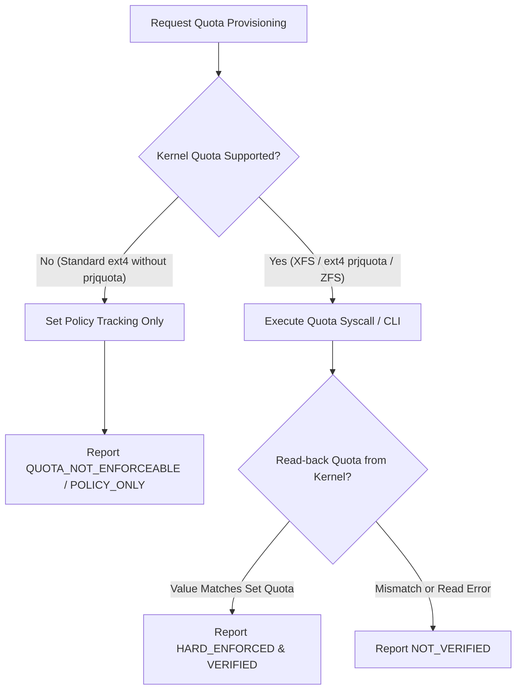

# 03 — STORAGE QUOTA ENFORCEMENT & DIRECTORY ISOLATION
**LabOps Control Center V2 — Resource Allocation & Storage Subsystem**

---

## 1. Directory Structure & Confinement Architecture

When an administrator provisions a member on an assigned storage drive, the system automatically creates a strictly isolated workspace hierarchy on that drive:

```
<Selected-Mount-Point>/labops/users/<username>/
├── work/          (0700, UID:GID) — Active source code and experiments
├── checkpoints/   (0700, UID:GID) — Model weights and training checkpoints
├── datasets/      (0700, UID:GID) — Cached user training datasets
└── .ssh/          (0700, UID:GID) — Authorized keys and host certificates
```

### 1.1 Confinement Invariants
1. **Host-vs-Container Decoupling**:
   - Host Path: `<selected-storage-root>/labops/users/<username>/` (e.g. `/media/LabOps-Data/labops/users/namnv`)
   - Container Mount Path: strictly fixed to `/workspace`
   - Docker Bind Mount: `/media/LabOps-Data/labops/users/namnv:/workspace:rw`
2. **Directory Isolation**:
   - Parent directory permissions: `0700` (`drwx------`) owned by the researcher's UID/GID.
   - Sibling researchers have zero read, write, or traversal access to each other's storage roots.
3. **Symlink Traversal Immunity**:
   - The provisioner resolves real canonical paths via `filepath.EvalSymlinks` and rejects any path pointing outside `<mount>/labops/users/<username>`.
   - Symlinks to system paths (`/etc`, `/proc`, `/home`) are detected during admission and trigger `SECURITY_VIOLATION`.

---

## 2. Kernel Quota Implementations

The Go Node Agent (`go/internal/storage/quota.go`) supports three kernel-level quota mechanisms:

### 2.1 XFS Project Quotas
On XFS filesystems mounted with `prjquota` or `pquota`:
1. **Project ID Generation**: A unique 32-bit project ID is derived from the member's UID (e.g. `ProjectID = 20000 + UID`).
2. **Directory Assignment**:
   ```bash
   xfs_quota -x -c 'project -s -p <directory> <project_id>' <mount_point>
   ```
3. **Hard Limit Enforcement**:
   ```bash
   xfs_quota -x -c 'limit -p bhard=<quota_bytes> <project_id>' <mount_point>
   ```
4. **Kernel Behavior**: Any write operation exceeding `bhard` fails instantly with `EDQUOT` (Disk quota exceeded) at the syscall layer (`write(2)`).

### 2.2 ext4 Project Quotas
On ext4 filesystems with kernel project quota enabled:
1. **Attribute Setting**:
   ```bash
   chattr -p <project_id> +P <directory>
   ```
2. **Quota Application**:
   ```bash
   setquota -P <project_id> 0 <quota_kb> 0 0 <mount_point>
   ```
3. **Kernel Behavior**: Cgroup and VFS intercept buffer writes and enforce limits per project ID.

### 2.3 ZFS Dataset Quotas
On ZFS storage pools:
1. **Child Dataset Creation**:
   ```bash
   zfs create <pool>/workspaces/<username>
   ```
2. **Refquota Configuration**:
   ```bash
   zfs set refquota=<quota_gb>G <pool>/workspaces/<username>
   ```

---

## 3. Read-Back Verification & Truthfulness Contract

The system **never** reports `HARD_ENFORCED` unless verified by active kernel telemetry:



### Truthfulness Contract
- When the drive does not support project quotas, the UI displays a clear amber warning badge:
  `⚠️ Không hỗ trợ quota filesystem (Chính sách giám sát - POLICY_ONLY)`
- When verified, the UI displays:
  `🛡️ EXT4_PROJECT / XFS_PROJECT (Cưỡng chế cứng - HARD_ENFORCED)`
