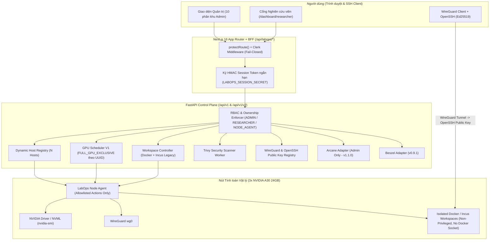

# KIẾN TRÚC TỔNG THỂ LABOPS CONTROL CENTER V2 (ARCHITECTURE)

## 1. Nguyên tắc Kiến trúc Cốt lõi
1. **Trung thực vận hành (No Fake Data / No Fake Success)**: Mọi chỉ số hiển thị đều mang theo `source`, `collected_at`, `freshness` (`ONLINE / STALE / OFFLINE / UNKNOWN`) và đơn vị đo. Mọi thao tác hạ tầng chỉ báo thành công khi đã xác minh ở runtime; nếu chưa xác minh thì hiển thị `PENDING_VERIFICATION`, `NOT_CONFIGURED`, `UNAVAILABLE` hoặc `BLOCKED_BY_INFRASTRUCTURE`.
2. **Tách biệt Desired State và Observed State**: Cơ sở dữ liệu PostgreSQL (`004_labops_v2_complete.sql`) và tầng dịch vụ tách riêng trạng thái mong muốn do Admin/Researcher yêu cầu với trạng thái thực tế do Node Agent/NVML/WireGuard quan sát được.
3. **Bảo toàn tuyệt đối Hạ tầng Đang Chạy**: Giữ nguyên Legacy SSH cổng 22 trên host, giao diện `wg0`, container Incus/Docker hiện hữu, và tiến trình nghiên cứu đang chạy.

---

## 2. Sơ đồ Kiến trúc Thành phần V2

---

## 3. Phân định Trách nhiệm Giữa Các Thành phần

| Thành phần | Trách nhiệm chính | Ranh giới an ninh |
|---|---|---|
| **Next.js BFF (`/api/labops/*`)** | Xác thực phiên Clerk, kiểm tra Origin chống CSRF, phát hành HMAC token ngắn hạn sang Backend | Không bao giờ tin `username`/`role` từ body hoặc header của trình duyệt |
| **FastAPI Control Plane** | Thực thi RBAC, kiểm tra quyền sở hữu tài nguyên, điều phối lịch GPU, quản lý vòng đời workspace và quét Trivy | Chặn mọi truy cập ẩn danh (`401`) và vượt quyền (`403`) |
| **LabOps Node Agent** | Thực thi danh sách thao tác cố định (`ALLOWED_AGENT_ACTIONS`) trên máy chủ tính toán | Dùng `LABOPS_NODE_AGENT_TOKEN` riêng; không nhận lệnh shell tùy ý |
| **Arcane (`v1.1.0`)** | Cung cấp góc nhìn quản trị Docker (container, image, volume, network, compose) cho Admin | Chỉ Admin được phép truy cập; Researcher hoàn toàn bị cô lập |
| **Beszel (`v0.9.1`)** | Thu thập lịch sử metrics và cảnh báo máy chủ/container | Khi chưa cấu hình, trả `NOT_CONFIGURED` và dùng fallback `psutil`/`nvidia-smi` cục bộ |
| **Trivy Scanner** | Quét tĩnh lỗ hổng, secret và misconfiguration theo đúng `repo_url` + `commit_sha` 40 ký tự | Không chạy script của repo; lưu vết phiên bản scanner/DB/policy |

