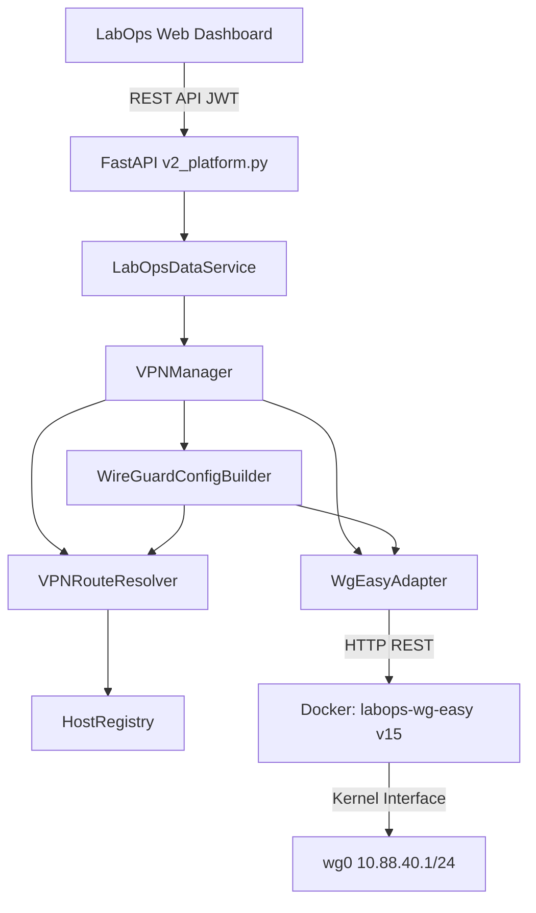

# KIẾN TRÚC DUY NHẤT DOCKER WG-EASY V15
## 02_SINGLE_WG_EASY_ARCHITECTURE.md

### 1. Nguyên tắc kiến trúc độc quyền

Hệ thống LabOps Control Center V2 chuyển dịch sang mô hình **Single Source of Truth** cho mạng riêng ảo:
1. **Chỉ một VPN Gateway duy nhất**: Container `labops-wg-easy` chạy WireGuard Kernel Module thông qua volume `/lib/modules:/lib/modules:ro` và `cap_add: [NET_ADMIN, SYS_MODULE]`.
2. **Loại bỏ cạnh tranh state (Dual Provider Elimination)**:
   - Toàn bộ việc cấp phát IP VPN (`10.88.40.0/24`), sinh client keypair, theo dõi traffic Rx/Tx, trạng thái handshake và thu hồi (revoke) do `WgEasyAdapter` điều phối qua REST API nội bộ `http://127.0.0.1:51821`.
   - Vô hiệu hóa `LegacyWireGuardProvider` khỏi runtime. Không còn cơ chế đọc tệp `/etc/wireguard/wg0.conf` hay chạy lệnh subprocess `wg set wg0 peer ...`.
3. **Chính sách Fail-Closed tuyệt đối**:
   - Khi `wg-easy` không khả dụng hoặc mất kết nối API, backend trả về lỗi chuẩn hóa `VPN_PROVIDER_UNAVAILABLE`.
   - Tuyệt đối cấm fallback về legacy provider hoặc dùng hardcoded mock key giả mạo.

### 2. Thành phần và mô hình lớp (Component Architecture)

### 3. Vòng đời quản lý thiết bị VPN (Device Lifecycle)

1. **Khởi tạo thiết bị (Enrollment)**:
   - Quản trị viên hoặc thành viên yêu cầu thêm thiết bị: `POST /api/v1/v2/members/{member_id}/devices`.
   - `VPNManager` gọi `WgEasyAdapter.create_device(name=f"{username}-{device_name}")`.
   - `wg-easy` cấp IP độc lập trong dải `10.88.40.x/32` và sinh cặp khóa mã hóa.
   - Bản ghi thiết bị được lưu trữ trong hồ sơ thành viên và DB `labops.db`.
2. **Tải cấu hình (.conf) & Thông tin SSH**:
   - `GET /api/v1/v2/members/{member_id}/devices/{device_id}/config`.
   - `WireGuardConfigBuilder` kiểm tra quyền sở hữu (RBAC: chỉ Admin hoặc chính chủ nhân thiết bị).
   - Truy vấn PublicKey và Endpoint thực tế từ `wg-easy`.
   - Phân giải lộ trình (`AllowedIPs`) và cổng SSH tương ứng qua `VPNRouteResolver`.
   - Xuất tệp WireGuard `.conf` hoàn chỉnh kèm companion OpenSSH config.
3. **Đình chỉ / Kích hoạt lại (Toggle Enable/Disable)**:
   - Gọi `POST /api/client/{id}/disable` hoặc `/enable` trên `wg-easy`.
   - Gói tin từ thiết bị bị kernel drop ngay lập tức khi disabled.
4. **Thu hồi vĩnh viễn (Revocation / Delete)**:
   - Gọi `DELETE /api/client/{id}` trên `wg-easy`.
   - Peer bị xóa khỏi kernel memory của WireGuard.
